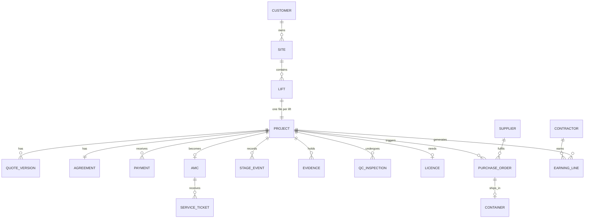
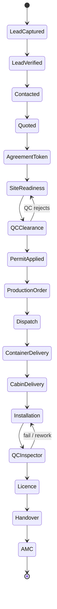

## 7. Business model and operating principles

**Asset-light platform.** AIEC holds no stock and no payroll. Workers are independent contractors under reviewed agreements (⚖️ classification risk, DEC-016). Money moves through authorised providers only.

**Four locks (V3§1):** no material leaves without payment · no worker is paid without proof · nobody bypasses the platform · no lift runs without a licence.

**Entity relationships**

**Canonical lifecycle** (preserved from V3§5; OCT has no licence stage → DEC-013):

