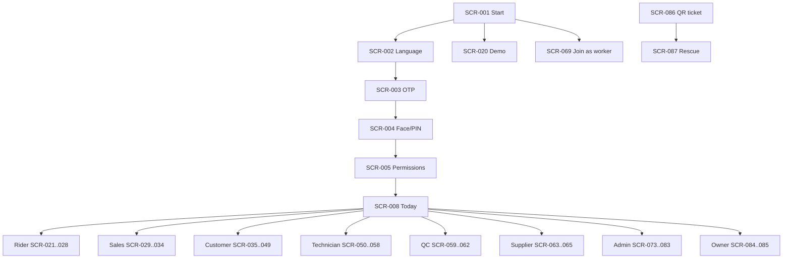

## 14. Navigation architecture

**Navigation checks performed during drafting (and to be repeated by the build agent):**

| Check | Result of this draft |
|---|---|
| Dead ends | Every screen has an exit: back, Today, or next step; failure states offer Retry/Help |
| Orphans | SCR-019 (recovery) is reached from SCR-003/004 "Can't log in"; SCR-006 from SCR-005; SCR-013 from top-bar bell; SCR-014 from offline banner |
| Duplicates | None with different names; SCR-044 (material handover) and SCR-046 (final handover) are deliberately separate events |
| Buttons without result | Each primary action in 13.2 defines its result in the module tables (section 15) and workflow rows (section 16) |
| Missing data | Representative must be named (SCR-042) before unlock (SCR-043); contract must exist before payment (SCR-036→037) |
| Unreachable states | Cancelled/Lost/Disputed/On hold exit paths in section 16.3 |
| Recovery paths | Failure matrix in section 34 |
| Known gap | Rescue console staffing and NBFC/Supplier onboarding screens depend on owner decisions DEC-011, DEC-006; wireframe pass must confirm |
