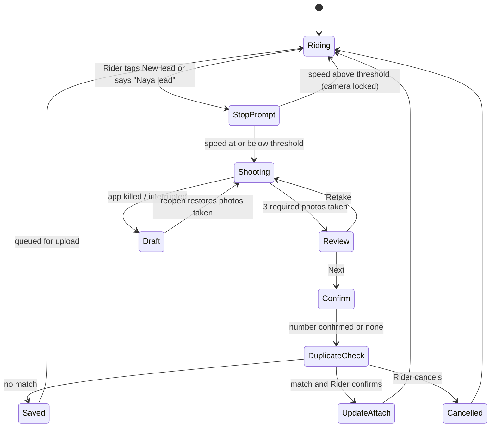

### 15.1 Field-level specification: Rider role (SCR-021 to SCR-028)

This is the first role specified to the full 20-item depth required by the brief (MP§7.3). It is the **model** for the remaining roles. Values marked **PROPOSED** are not in the sources and must be confirmed in the pilot; Marathi/Hindi strings are **drafts needing native-speaker review**. Theme: Outdoor high-contrast by default. All screens inherit section 13.1.

**Capture record (data collected, with source of each value)**

| Field | Type | Source of value | Required | Validation |
|---|---|---|---|---|
| capture_id | UUID | App, created before the first photo | Yes | Unique; idempotency key for upload |
| rider_id, role | ref | Session | Yes | Role must be Rider and on duty |
| photo_site, photo_shaft, photo_board | 3 images | In-app camera only | Yes (≥3 photos; extra allowed) | Stamped, hashed; no gallery import |
| gps_lat, gps_lng, gps_accuracy_m, gps_fix_time | numbers | Device | Yes | Accuracy stored; poor accuracy routes to review (GPS_DRIFT) |
| address_text | text | Reverse geocoding (provider TBD) | Auto | Rider may only confirm or tap "Wrong address" (then Coordinator fixes) |
| ward_area | text | Geofence/area lookup | Auto | — |
| contact_phone | digits | OCR proposal confirmed by Rider (number pad fallback) | Yes unless "no contact available" | 10-digit Indian mobile pattern; duplicate check; stored then masked |
| contact_role | choice | Rider taps: Owner · Builder · Site engineer · Watchman · Other | Optional | One tap |
| consent_whatsapp | recorded yes/no | Rider records the contact's spoken answer after reading the script | Required to enable outreach | Script version, language, audio clip, timestamp, authority tap |
| consent_calls | recorded yes/no | Same, separate question | Optional | Stored per channel (TRAI/DND rules, R-20) |
| tower_label | choice | Rider taps Tower A/B/… or "Single building" | Optional | Needed for duplicate matching |
| floors_estimate | number | Rider number pad or "Not sure" | Optional | 1–99 |
| capture_speed_kmh | number | Device | Auto | Must be at or below stop threshold at shutter |
| device_signals | flags | App | Auto | mock-location/root signals stored as evidence for review, not proof of fraud |

**Stop-to-capture state machine**



Stop threshold: **PROPOSED** 5 km/h with GPS-error tolerance, configurable by Admin; not a legal-grade value and must be tested on real bikes.

#### SCR-021 Rider start day

| Item | Specification |
|---|---|
| Purpose / role | Open the working day, verify the person, start tracking. Rider only |
| Entry / exit | From Today "START DAY" card → SCR-022 Rider map. Back = Today |
| Header | "Start day · दिवस सुरू" , language chip, speaker, Help |
| Layout | Top: sports-bike icon + today's date. Middle: tracking permission status row (green/red) and insurance status row. Bottom: one large button "START DAY" |
| Primary action | START DAY: front camera selfie → on-device face check against enrolment → foreground tracking service starts with visible on-duty notification |
| Secondary | "Why is location needed?" (voice + picture, opens consent notice SCR-006); "Help" |
| Inputs / defaults | Selfie (camera only). No typing |
| Validation / errors | Face mismatch ×2 → "We could not match your face. Ask your Coordinator" → review task (never a ban). Location off → "Turn on location to start your day" + button to settings. Insurance record missing → blocked: "Cover not active — call Coordinator" (RIDER_COVER) |
| States | Loading: skeleton rows. Empty: n/a. Success: green check, spoken "Day started", tracking banner shown. Failure: reason + retry + Help. Offline: allowed — start is queued, tracking records locally, banner "Saved on phone". Permission denied: location or camera explained with deep link |
| Visibility | Rider only; Coordinator sees status |
| Data shown / source | Duty state, permission status (device), insurance status (server cache) |
| Automation | AUT-021 sync; duty start event written; silent-30-minute alert armed (BG_TRACK) |
| Audit / evidence | Selfie hash, face-match result, time, GPS, device; stored as identity evidence |
| Responsive | Single column; button ≥30% height; works 360 px |
| Accessibility | Voice line on open; labels on status rows with text+icon; 48 dp targets |
| Tests | T-007, T-126, AIEC-TEST-0174 |

#### SCR-022 Rider map

| Item | Specification |
|---|---|
| Purpose / role | Show where the Rider has been, which leads exist, which areas are covered or suggested. Rider |
| Entry / exit | From SCR-021 or Today "Map" tab. Tapping a pin opens a bottom sheet → SCR-026. "NEW LEAD" → SCR-023 |
| Header | Day counters: km today, leads today, area covered |
| Layout | Map fills screen. Floating layer button (4 toggles: My path, Lead pins, Covered area, Suggested areas). Bottom bar: big "NEW LEAD" button (≥56 dp). Counters card collapsed to one line |
| Primary action | NEW LEAD (opens stop prompt) |
| Secondary | Layer toggles; "List view" (accessible alternative to map); recentre; End day link in Me menu |
| Inputs / defaults | Layers default: path ON, pins ON, covered ON, suggested ON. Other riders' covered zones shown shaded **without their pins** |
| Validation / errors | Map tiles unavailable → "Map not loaded. Your path is still saved" + list view. GPS lost → amber banner "Weak GPS. Last position shown" |
| States | Loading: grey tiles + skeleton counters. Empty: "No leads yet today — ride to a new area" with arrow to nearest suggested area. Offline: cached tiles of the working area if downloaded; otherwise list view; pins from cache |
| Visibility | Own leads and status; others' coverage only as shaded area; no other riders' pins or customer data |
| Data shown / source | Path (device), pins and status (server), coverage polygon (server from tracks), suggestions (server from lawful public data + conversion history; never claims complete registry coverage) |
| Automation | Suggested areas refreshed daily; coverage recalculated on sync |
| Audit | Tracking points stored duty-only; map reads of other-rider coverage are aggregated |
| Responsive | Bottom sheet for pin detail; no horizontal scroll; layer panel as bottom sheet below 360 px height |
| Accessibility | List view lists every pin with address, status, distance; map not required for any action; pins have text labels |
| Tests | T-123, T-124, AIEC-TEST-0175 |

#### SCR-023 Stop-to-capture lead

| Item | Specification |
|---|---|
| Purpose / role | Capture proof of a lift-ready site. Rider |
| Entry / exit | From SCR-022 NEW LEAD or voice "Naya lead". Next → SCR-024 |
| Header | "Step 1 of 3: Site · पायरी १ : साइट" with 3-dot progress |
| Layout | Full-screen camera. Ghost outline showing what to frame (building, shaft, board). Counter "1/3". Large round shutter. Strip of thumbnails. "Retake" per thumbnail |
| Primary action | Shutter ×3 (site, shaft, site board), each stamped (GPS, time, name, role, address, project ID if known) |
| Secondary | Torch toggle; "Skip board photo — no board" (allowed only with reason tap: No board / Not allowed); Help |
| Inputs / defaults | 2–5 photos; first three are mandatory types in order. No typing |
| Validation / errors | Speed above threshold → locked screen "Stop safely to capture · सुरक्षितपणे थांबा". Blurry/dark (on-device check) → "Photo too dark — use torch". Screen-photo or reused photo detected → amber, goes to review, Rider may continue. Fewer than 3 → Next disabled with "Take 2 more photos" |
| States | Loading: camera opening spinner ≤2 s then text. Success: thumbnail strip with ticks. Failure: camera error → "Camera not working" + Help. Offline: unaffected; photos saved encrypted. Permission denied: camera → full-screen explanation, no gallery fallback, offer "Ask Coordinator to assist" (ASSISTED); location denied → capture blocked ("proof needs location") |
| Visibility | Rider only |
| Data shown / source | Camera, GPS, speed (device) |
| Automation | AUT-020 completeness check queued; draft auto-saved after every shutter |
| Audit / evidence | capture_id, per-file hash, original + rendered stamped copy, device signals |
| Responsive | Portrait lock; shutter within thumb reach; works on 360×640 |
| Accessibility | Spoken prompts "Take site photo"; shutter has label and haptic; ghost outline not required for completion |
| Tests | T-010, T-011, T-062, T-063, AIEC-TEST-0176 |

#### SCR-024 Lead confirm and consent

| Item | Specification |
|---|---|
| Purpose / role | Confirm the contact and record the contact's spoken consent. Rider |
| Entry / exit | From SCR-023 Next → duplicate check → SCR-025 or save → Map |
| Header | "Step 2 of 3: Contact · पायरी २ : संपर्क" |
| Layout | Board photo with OCR number highlighted; number shown in large digits with two buttons: ✔ "Correct" / ✎ "Change" (number pad); contact-role chips; tower chips; then Consent card with script text, "Play script" and a large red-dot "Record yes" button |
| Primary action | Confirm number → read script aloud to the contact → record the answer → SAVE LEAD |
| Secondary | "No contact available" (saves lead with no outreach and no consent); "Contact said no" (saves lead, outreach disabled); Help |
| Inputs / defaults | Number defaults to OCR proposal; consent channels default **off** until recorded; script language defaults to contact's language chosen by Rider tap (Marathi/Hindi/English) |
| Validation / errors | Number not 10 digits → "Check the number · क्रमांक तपासा" and number pad stays open. Number already known → goes to SCR-025. Consent clip under 2 s or silent → "Recording too short — record again". "Is this person authorised?" tap (Yes/No/Not sure): "No/Not sure" blocks consent recording and saves lead without outreach |
| States | Loading: OCR spinner with manual fallback after 3 s. Success: saved toast with Undo 10 s. Failure: save error keeps all entries as draft. Offline: saves to queue; duplicate check uses cached nearby leads and is finalised on sync. Permission denied: microphone denied → consent cannot be recorded → lead saved without consent, message explains outreach will not happen |
| Visibility | Rider sees number **until save**, then masked |
| Data shown / source | OCR (provider TBD), Rider taps, script text from approved consent template (⚖️ lawyer-approved wording, name "ALL INDIA ELEVATORS COMPANY" read aloud, purpose and channel stated, version stored) |
| Automation | AUT-003 duplicate warning; AUT-005 outreach only if consent_whatsapp recorded and not opted out |
| Audit / evidence | Consent audio, script version, language, authority answer, timestamp, rider ID; phone stored encrypted; reads logged |
| Responsive | Number pad inside screen, not OS keyboard; consent card scrolls inside own area |
| Accessibility | Script has captions; record button states announced; audio feedback on start/stop |
| Tests | T-009, T-012, T-017, T-019, AIEC-TEST-0177, AIEC-TEST-0178 |

#### SCR-025 Duplicate warning

| Item | Specification |
|---|---|
| Purpose / role | Prevent a second lead for the same site. Rider |
| Entry / exit | Auto from duplicate check. "Add update" → saves as update → Map. "Cancel" → Map |
| Header | "This site already exists · ही साइट आधीच आहे" |
| Layout | Original lead card (photo, area, status, date, "found by another rider" with no name). Rule box in plain words: attribution window, share if update adds something new. Two buttons |
| Primary action | ADD UPDATE (attaches new photos/number as update) |
| Secondary | CANCEL; Help |
| Inputs / defaults | Default selection: Add update. Rider tick "I have something new" (new contact / new tower / new photo) required to claim any share |
| Validation / errors | Update adds nothing new → message "No new information — no commission share" but allowed. Different tower detected → prompt "New tower? Create new lead" |
| States | Loading: skeleton. Offline: provisional match from cache; text "Will be confirmed when online". Conflict after sync → both entries kept for Admin review |
| Visibility | No other rider's identity, phone or earnings shown |
| Data shown / source | Matching by geofence (≈50 m), tower, contact, time window; rule values from configuration (60-day window and 10% share are PROPOSED, DEC-007) |
| Automation | AUT-003, AUT-025 (one claim per lead+rider) |
| Audit | Match inputs, rider choice, new-information flag |
| Responsive / a11y | Two big buttons stacked; spoken explanation; no colour-only cue |
| Tests | T-013, T-014, T-015, AIEC-TEST-0179 |

#### SCR-026 Lead detail (Rider view)

| Item | Specification |
|---|---|
| Purpose / role | Show status of the Rider's lead. Rider (own leads) and Sales |
| Entry / exit | From map pin or lead list. Back = Map |
| Layout | Photos carousel, address, area, status line (captured → verified → contacted → quoted → won → installed) with the current step highlighted, masked contact "98••••••21", commission status chip |
| Primary action | None required; optional "Add update" if on site again (opens SCR-023 with lead pre-selected) |
| Validation / states | Verification pending: yellow chip "Checking · तपासणी". Rejected (e.g. photo of screen, outside geofence): red chip with picture reason and "Ask human review" button. Offline: cached view |
| Visibility | Own leads only; no customer name, quote, price, margin or payment details |
| Automation | Status updates push to Rider |
| Tests | T-012, T-065, AIEC-TEST-0180 |

#### SCR-027 Rider earnings and leaderboard

| Item | Specification |
|---|---|
| Purpose / role | Show what is pending, payable, paid; rank. Rider |
| Layout | Coin-stack total; three chips: Pending (token paid, awaiting QC clearance), Payable, Paid; list of leads with amounts; leaderboard card ranked by **won deals and verified leads**, weekly/monthly toggle, shows counts |
| Primary action | Open a lead's earning line → evidence and reason |
| Validation / errors | Amount undefined by owner → shows "Amount not set yet" (never a guessed figure) (DEC-028). Dispute → "Ask about this amount" opens chat with Coordinator |
| States | Offline: last synced values with timestamp. Empty: "Your first verified lead will appear here" |
| Visibility | Own earnings; leaderboard shows rank and counts, not other riders' amounts |
| Data shown / source | Ledger lines (never calculated on the phone) |
| Automation | AUT-025 commission eligibility; payout per decided model |
| Audit | Reads of ledger logged |
| Tests | T-014, T-081, AIEC-TEST-0181 |

#### SCR-028 Rider end day

| Item | Specification |
|---|---|
| Purpose / role | Close the day and sync. Rider |
| Layout | Summary: leads, km, area, pending sync items, earnings change, rank, suggested area for tomorrow |
| Primary action | END DAY: forces sync of queue, then stops tracking and removes the on-duty notification |
| Validation / errors | Sync incomplete (offline) → "3 items still on phone. They will send when network returns" — allowed to end day; queue continues in background. Unsaved draft lead → prompt to finish or discard (discard needs confirm) |
| States | Success: spoken "Day ended" and summary stored. Failure: stays on duty with retry |
| Automation | AUT-021 sync; tracking service stops; day record closed |
| Audit | Duty end time, GPS, queue state |
| Tests | T-066, T-123, AIEC-TEST-0182 |

#### Rider message catalogue (English keys; mr/hi drafts need review)

| Key | English | मराठी (draft) |
|---|---|---|
| rider.stop_to_capture | Stop safely to capture | सुरक्षितपणे थांबा, मग फोटो घ्या |
| rider.photo_dark | Photo too dark. Use the torch | फोटो अंधारा आहे. टॉर्च वापरा |
| rider.number_check | Check the number | क्रमांक तपासा |
| rider.consent_short | Recording too short. Record again | रेकॉर्डिंग खूप लहान आहे. पुन्हा करा |
| rider.dup_found | This site already exists | ही साइट आधीच आहे |
| rider.no_new_info | No new information, so no commission share | नवीन माहिती नाही, म्हणून कमिशन वाटा नाही |
| rider.saved_phone | Saved on phone. Will send when network returns | फोनमध्ये सेव्ह झाले. नेटवर्क आल्यावर पाठवले जाईल |
| rider.face_fail | We could not match your face. Ask your Coordinator | चेहरा जुळला नाही. समन्वयकाला विचारा |

**Rider-role wireframes**

```
SCR-022 Rider map                    SCR-023 Capture
┌─────────────────────────────┐      ┌─────────────────────────────┐
│ 🏍  42 km · 5 leads · 3.1 km²│      │ Step 1 of 3: Site  ●○○      │
│ ┌─────────────────────────┐ │      │ ┌─────────────────────────┐ │
│ │      MAP (path, pins,   │ │      │ │   ghost outline of      │ │
│ │  shaded covered area,   │ │      │ │   building + shaft      │ │
│ │  suggested ▒▒ area)     │ │      │ │                         │ │
│ │  [layers]        [list] │ │      │ └─────────────────────────┘ │
│ └─────────────────────────┘ │      │  [thumb][thumb][ + ]        │
│ ┌─────────────────────────┐ │      │        ( ◉ SHUTTER )        │
│ │      ＋  NEW LEAD       │ │      │ [torch]  [Help]    [SOS]    │
│ └─────────────────────────┘ │      └─────────────────────────────┘
│ Today  Map  Chat  Money  Me │       ("SOS" only where role has it;
└─────────────────────────────┘        Rider SOS per SOS requirement)

SCR-024 Confirm and consent
┌─────────────────────────────┐
│ Step 2 of 3: Contact        │
│ [board photo, number boxed] │
│  98 ▮▮▮▮ ▮▮ 21              │
│ [✔ Correct]   [✎ Change]    │
│ Is this person authorised?  │
│ [Yes] [No] [Not sure]       │
│ Script ▶ (Marathi ▼)        │
│ ┌─────────────────────────┐ │
│ │   ● RECORD "YES"        │ │
│ └─────────────────────────┘ │
│ [No contact available]      │
└─────────────────────────────┘
```

**Rider acceptance tests added for field-level behaviour:** AIEC-TEST-0174 to AIEC-TEST-0182 (section 36). **Open items for the Rider role:** stop-speed threshold, consent script wording (⚖️), commission amounts (DEC-028), insurance product (DEC-016/RIDER_COVER), OCR and geocoding providers (EXTERNAL INTEGRATION REQUIRED). The SOS button is carried on Rider capture screens because the sources require SOS on all field screens (SCREEN_GRAMMAR rule 8).
