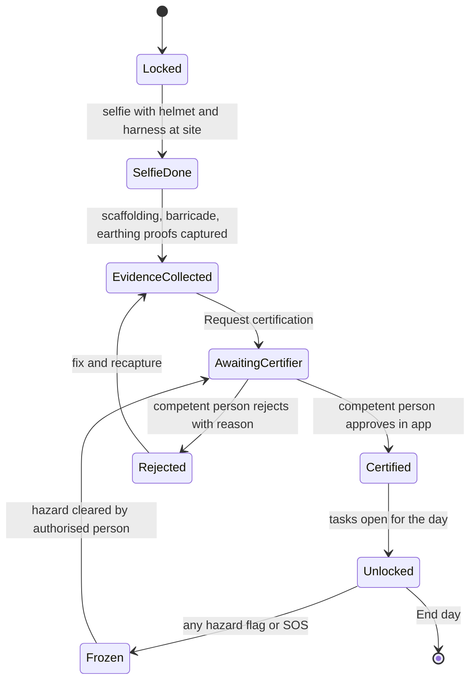

### 15.2 Field-level specification: Technician role (SCR-017, SCR-050 to SCR-058)

Same depth and conventions as 15.1. **Safety principle for every screen below:** a checkbox never completes a safety-critical task; where life is at risk a qualified human decides; the app freezes work when in doubt. Numeric tolerances, test values and the list of safety-critical items are **not in the sources** and are authored by the licensed lift engineer (⚖️); this document only defines where those values plug in. Theme: Outdoor high-contrast. All screens inherit section 13.1.

**Records the Technician screens create**

| Record | Key fields | Created by | Rule |
|---|---|---|---|
| Job offer response | offer_id, contractor_id, accept/decline, time | SCR-050 | Needs signed contractor agreement and matching skill/level; decline carries no penalty |
| Arrival event | project_id, GPS, accuracy, geofence result | SCR-051 | Inside site geofence (≈50 m; basement tolerance up to 100 m with last good fix) else review task |
| Daily safety gate | gate_id, date, selfie, scaffolding evidence, barricade evidence, earthing evidence, certifier_id, certified_at | SCR-052 | Each evidence item must exist before certification request; certifier must hold the competent-person qualification set by the lift engineer |
| SOP step proof | step_id, SOP version, evidence ids, AI result, human result, peer result | SCR-053/054 | Version pinned at job start; no step completes without evidence and the applicable approver |
| Material request | bom_line, serial, damage photo, emergency flag | SCR-055 | Photo with serial mark required; emergency path allows a human decision |
| Pause request | reason, proof, requested_by, decided_by, days excluded | SCR-056 | Admin approves; paused days leave the clock |
| End-day record | progress, provisional earnings, PDF id, queue state | SCR-057 | Triggers daily safety PDF |

**Daily safety gate state machine**



If no certifier answers within the response limit (**OWNER DECISION**, not in sources), the Coordinator then Admin are alerted and tasks **stay locked**; there is no override that unlocks safety-critical work without certification. Offline: evidence is saved on the phone; certification needs the certifier's server-confirmed approval, so tasks remain locked and the screen offers "Call Coordinator".

#### SCR-050 Job offers

| Item | Specification |
|---|---|
| Purpose / role | Show eligible jobs; accept or decline. Technician (Trainee sees only approved low-risk jobs, TRAINEE_RULES) |
| Entry / exit | Today card or notification → offer card → accepted job opens SCR-051 on the job day |
| Layout | Card per offer: area, lift type, floors, rate shown by agreed basis (per lift or per sub-stage — DEC-029), start date, expected 14-day window (DEC-022), crew members. Two large buttons ACCEPT / DECLINE |
| Primary / secondary | ACCEPT; DECLINE (no reason required, no penalty); Help |
| Inputs / defaults | None; no typing |
| Validation / errors | Contractor agreement unsigned → "Sign your agreement first" link. Skill/level mismatch → offer not shown. Offer already taken → "Job taken by another team" |
| States | Empty: "No jobs now. We will tell you." Offline: cached offers marked "Not confirmed"; accept queued but job not assigned until server confirms |
| Visibility | Own offers; rate only for own level; no customer personal data until accepted |
| Automation | Offers skill-matched; acceptance idempotent per offer_id; unaccepted offer expires and goes to next eligible technician |
| Audit | Offer, response, timing |
| Responsive / a11y | One card per screen width; spoken summary including amount; both buttons ≥56 dp |
| Tests | T-143, AIEC-TEST-0183 |

#### SCR-051 Site arrival and geofence

| Item | Specification |
|---|---|
| Purpose | Prove presence at the right site before work. Technician |
| Layout | Map card with geofence circle, distance remaining, big button CHECK IN. Status row: location OK / weak |
| Primary action | CHECK IN → location fix and accuracy stored → opens SCR-052 |
| Validation / errors | Outside geofence → "You are 240 m from the site" with directions. Poor accuracy/basement → uses last good fix within tolerance, otherwise review task to Coordinator; Technician may still proceed to the safety gate **only** after Coordinator accepts. Mock-location signals → amber evidence flag (human review, not accusation) |
| States | Offline: check-in queued; safety gate can be prepared but certification needs network. Permission denied: location → blocked with explanation and Coordinator assist |
| Audit / evidence | GPS, accuracy, device signals, time |
| Tests | T-007, AIEC-TEST-0184 |

#### SCR-052 Daily safety gate

| Item | Specification |
|---|---|
| Purpose | Daily go/no-go for work at height. Technician; certifier role sees the approval view |
| Entry / exit | After SCR-051. On Certified → SCR-053 first open step. On Frozen → SOS/incident |
| Layout | Progress "1 of 4" with four rows: Helmet + harness selfie · Scaffolding · Shaft barricade · Power earthing. Each row opens the camera (selfie or 10 s video + photo). Padlock banner "Work locked until certified". Button REQUEST CERTIFICATION enabled when all rows have evidence |
| Primary action | Capture evidence per row, then REQUEST CERTIFICATION |
| Secondary | "Report hazard" (red) → freezes work; SOS; Help |
| Inputs / defaults | Camera only; no tick-box path; selfie is identity evidence only, not proof of safe conditions |
| Validation / errors | Missing row → button disabled with row highlighted. AI reports no helmet/harness visible → amber, "Show helmet and harness clearly", human review available; hazards never auto-cleared by AI. Certifier rejects → reason shown in plain language and recapture rows only for the rejected items |
| States | Awaiting certifier: yellow "Waiting for <role>" with call button. Certified: green check, spoken "Safety approved. Work open." Frozen: red banner, only SOS/incident/Help active. Offline: evidence saved; request queued; tasks locked |
| Visibility | Technician sees own team's gate; certifier sees evidence and certifies; Admin sees all |
| Data shown / source | Evidence (camera), certifier identity and qualification (server), gate rules (configuration, engineer-defined) |
| Automation | AUT-027 safety stop; AUT-020 completeness; certification request routes to certifier by site/availability |
| Audit / evidence | Every evidence hash, certifier ID, qualification at time, decision, reason; faces blurred in builder PDF copy, originals access-controlled |
| Responsive / a11y | Four rows stacked; large icons with text; spoken instructions per row; red hazard button reachable but separated from capture buttons |
| Tests | T-052, T-053, AIEC-TEST-0185, AIEC-TEST-0186 |

#### SCR-053 SOP step

| Item | Specification |
|---|---|
| Purpose | Perform and prove one SOP step. Technician |
| Entry / exit | Only when the safety gate is Unlocked, the previous step is approved, required materials match the BOM. Exit → next step or SCR-054 peer check |
| Layout | Top: step name with sub-stage chip (1 site check, 2 rails, 3 cabin/machine/roping, 4 electrical, 5 test/commissioning). Video player 20–40 s with captions and voice; "Tools and materials" row with pictures; evidence list with ghost outlines; button START PROOF CAMERA |
| Primary action | Watch video → capture 2–5 photos or the 10-second video required by the step → submit |
| Secondary | Replay video; Report problem (opens SCR-055); Request pause (SCR-056); SOS |
| Inputs / defaults | Evidence list comes from the pinned SOP version; no free text |
| Validation / errors | Missing item → "Take the 10-second video" (named item). AI amber/red → picture reason and "Ask human review" (no penalty). Safety-critical step (earthing, brakes, overspeed governor, safety gear, door interlocks, final test) → after upload shows "Waiting for QC approval" and **cannot** be completed by the Technician or AI alone. Earthing test reading photo requires the instrument display legible |
| States | Loading: video skeleton. Offline: video cached when job accepted; evidence queued; step shown as "Saved on phone — waiting to send" and provisional earnings **not** shown until server accepts. Blocked: padlock with reason (customer/supplier/permit/defect/gate) |
| Visibility | Assigned team; QC and Admin read evidence; Customer sees only stage photos chosen for the tracker |
| Data shown / source | SOP version, videos (engineer-authored, ⚖️), BOM lines, step approval states |
| Automation | AUT-020 evidence completeness; AUT-001 task creation; AUT-023 QC failure handling; earnings enter ledger as Provisional only after accepted proof (PAID_ON_PROOF) |
| Audit / evidence | Full evidence record (capture id, hash, stamp, checks, reviewer), SOP version pinned |
| Responsive / a11y | Video captions; touch targets ≥48 dp; evidence rows as large tiles; voice reads step title and what to capture |
| Tests | T-056, T-064, T-065, T-108, AIEC-TEST-0187 |

#### SCR-054 Peer check

| Item | Specification |
|---|---|
| Purpose | Independent 3-point check of the previous sub-stage before the next starts. Technician of **another team**, or QC |
| Entry / exit | Assigned automatically; never offered to the team that did the work. Approve → previous team's earnings move toward Confirmed; Reject → defect |
| Layout | Previous team's evidence thumbnails on top; three checklist points (taken from the SOP, one photo each); buttons APPROVE / FOUND A PROBLEM |
| Primary action | Capture 3 photos at the actual work, answer approve/problem |
| Validation / errors | Same team or same person → blocked "Not allowed: your own work". Problem → photo of defect + defect type chips → creates defect, rework task and points reduction pending review |
| States | Offline: result queued; next sub-stage stays locked until server records it |
| Visibility | Evidence of the checked sub-stage only; no earnings or personal data of the other team |
| Automation | Peer approval moves earnings Provisional → eligible for QC/Admin confirmation; defect triggers AUT-023 |
| Audit | Checker identity, evidence, decision |
| Tests | T-055, AIEC-TEST-0188 |

#### SCR-055 Extra material or defect report

| Item | Specification |
|---|---|
| Purpose | Report a damaged or missing part, or request extra material. Technician |
| Layout | Pick BOM line from pictured list; camera for damaged part with serial mark; big REQUEST button; red "Safety emergency" toggle |
| Validation / errors | No photo → blocked. Emergency toggle on → human decision path opens (not blocked) with Admin alert; installation continues on other safe sub-stages |
| Automation | Supplier claim opened (MATERIAL_CLAIM); Admin approves any extra material; BOM guard prevents unlisted items |
| States | Offline: queued; "Will send when network returns" |
| Audit | Serial, photo, BOM line, approver |
| Tests | T-045, T-138, AIEC-TEST-0189 |

#### SCR-056 Pause request

| Item | Specification |
|---|---|
| Purpose | Stop the 14-day clock fairly. Technician |
| Layout | Five reason tiles with pictures: Customer, Supplier, Weather, Permit, Defect; camera for proof; REQUEST PAUSE |
| Validation / errors | No proof → blocked; reason chosen but Admin rejects → returned with reason and clock continues |
| Rules | Approved pause excludes days from the clock and suspends worker penalties; reasons not caused by the worker never reduce trust (HONESTY/SITE_START_14D) |
| Automation | Admin approval task, response limit **OWNER DECISION** |
| Tests | T-051, AIEC-TEST-0190 |

#### SCR-057 Technician end day

| Item | Specification |
|---|---|
| Purpose | Close the day, send the safety log. Technician |
| Layout | Today's steps with ticks (accepted / waiting / blocked), provisional earnings, sync status, button END DAY |
| Primary action | END DAY: sync queue, close gate, generate daily safety PDF for builder |
| Validation / errors | Unsynced evidence → allowed to end; queue continues; PDF marks "evidence pending" until arrival. Open hazard flag → cannot end day silently: must be reported |
| Automation | Safety PDF (SAFETY_PDF), builder email/app copy with faces blurred, originals access-controlled |
| Audit | Day record, PDF hash |
| Tests | T-054, T-066, AIEC-TEST-0191 |

#### SCR-058 Technician money

| Item | Specification |
|---|---|
| Purpose | Show where money is. Technician |
| Layout | Coin-stack total; bucket chips: Provisional · Confirmed · Payable this weekend · Bond/Reserve (only if model uses it) · Disputed; list of lines with project, step, reason; "Ask about this amount" |
| Validation / errors | **Payout model not yet decided (DEC-001):** the screen shows buckets and statuses only and displays "Payout rules to be announced" instead of any date or percentage until the owner approves a model. Amounts come only from the ledger; phone never calculates money |
| States | Offline: last synced with timestamp; Empty: "Your earnings appear after your first approved step" |
| Rules | Confirmed = QC pass + Admin approval; rating never changes base pay; paid only when provider confirms; disputed amounts isolated |
| Audit | Reads of ledger logged |
| Tests | T-070, T-072, T-073, AIEC-TEST-0192 |

#### SCR-017 SOS (shared by Rider, Technician, QC)

| Item | Specification |
|---|---|
| Purpose | One-tap emergency. Always reachable (red button, bottom corner, every field screen) |
| Primary action | Tap → confirm slider-free single press-and-hold (1 s, not drag; WCAG 2.5.7) → 112 dialler opens **immediately** without waiting for the server → in parallel alert Admin and site contact, send GPS, freeze site work, open incident form |
| Validation / errors | No data → SMS attempted where the phone allows and the screen shows delivery state: Sent / Not sent. No SIM → message "Call from another phone" with site address displayed large |
| Exempt | No Undo bar; unaffected by quiet hours or sound settings |
| Audit | Press time, GPS, delivery results, recipients |
| Tests | T-058, T-059, AIEC-TEST-0193 |

**Technician message catalogue** (mr drafts need native-speaker review)

| Key | English | मराठी (draft) |
|---|---|---|
| tech.work_locked | Work locked until safety is approved | सुरक्षा मंजूर होईपर्यंत काम बंद आहे |
| tech.show_ppe | Show helmet and harness clearly | हेल्मेट आणि हार्नेस स्पष्ट दाखवा |
| tech.wait_qc | Waiting for QC approval | QC मंजुरीची वाट पाहत आहे |
| tech.not_own_work | Not allowed: this is your own work | परवानगी नाही: हे तुमचे स्वतःचे काम आहे |
| tech.ai_ask_human | Ask a person to check this | हे तपासण्यासाठी माणसाला सांगा |
| tech.rules_later | Payout rules to be announced | पेमेंटचे नियम लवकरच जाहीर होतील |
| tech.hazard_frozen | Hazard reported. All work stopped | धोका नोंदवला. सर्व काम थांबले |

**Technician wireframes**

```
SCR-052 Safety gate                  SCR-053 SOP step
┌─────────────────────────────┐      ┌─────────────────────────────┐
│ Safety check  2 / 4         │      │ Rails · step 3  [chip: 2]   │
│ ✔ Helmet + harness selfie   │      │ ┌─────────────────────────┐ │
│ ▶ Scaffolding   [🎥][📷]    │      │ │  ▶ video 0:28  (captions)│ │
│ ○ Shaft barricade           │      │ └─────────────────────────┘ │
│ ○ Power earthing            │      │ Tools: [img][img][img]      │
│ 🔒 Work locked until        │      │ Capture: 10 s plumb video   │
│  the competent person       │      │ ┌─────────────────────────┐ │
│  certifies                  │      │ │  🎥  START PROOF CAMERA │ │
│ [REQUEST CERTIFICATION] off │      │ └─────────────────────────┘ │
│ [Report hazard]   [SOS]     │      │ [Problem] [Pause]   [SOS]   │
└─────────────────────────────┘      └─────────────────────────────┘
```

**Open items for the Technician role:** competent-person definition and qualification (⚖️ lift engineer), safety-critical item list, per-step evidence lists and tolerances (engineer-authored SOP), certifier response limit and pause-approval limit (OWNER DECISION), payout model (DEC-001), rate basis (DEC-029), AI vendor and false-reject rate (first 30 jobs fully human-reviewed), and whether the press-and-hold duration for SOS suits gloved hands (field test).
