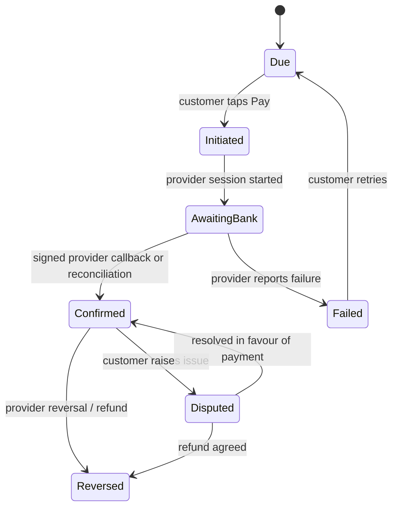

### 15.3 Field-level specification: Customer role (SCR-035 to SCR-049)

Same conventions as 15.1 and 15.2. The Customer is an office-grade user (builder, society, owner): **Light glass** theme by default, works as installed web app/PWA or native app, but every money, signature and unlock action is confirmed on the server. Legal wording, amounts and trigger points shown here come from **configuration approved by the lawyer, CA and payment partner** — screens never invent them. All screens inherit section 13.1.

**Records the Customer screens create or change**

| Record | Key fields | Rule |
|---|---|---|
| Agreement signature | agreement_version, signatory_id, authority_proof_id, language_version, audio_played, esign_certificate_id, time | Signatory must hold verified authority; the text and audio the customer saw are stored |
| Payment attempt | milestone, amount (paise), method, provider_reference, status | Status only from verified provider callback/reconciliation (PAY_TRUTH); screen never marks Paid |
| EMI consent and application | borrower_id, consent_record, nbfc_status | Borrower may differ from signatory (CUST_PARTIES); status only from NBFC |
| Readiness submission | checklist_item, photos, source (camera / customer-supplied), time | Gallery uploads are tagged "customer-supplied, not geostamped" (PROPOSED) and verified by QC on site |
| Representative delegation | person, phone, ID photo, delegation proof, valid_for_delivery_id | One named person per delivery; face enrolled at delivery |
| Unlock approval (key 1 of 3) | container_id, representative_id, face_result, time | Valid only with the other two keys and confirmed delivery payment (CONTAINER_LOCK) |
| Variation decision | variation_id, accept/decline, eSign | Production blocked until accepted |
| Handover signature | handover_id, signatory, time | Three parties; blocked until licence recorded |
| Rating (optional) | stars, comment | Bonus/promotion only; auto-accepted after 7 days |

**Payment state model (customer-visible)**



A success page in the browser or app **does not** move a payment to Confirmed. Duplicate callbacks are ignored by idempotency key.

#### SCR-035 Quote and negotiation chat

| Item | Specification |
|---|---|
| Purpose / entry | See quote, negotiate, accept. From WhatsApp link, notification or Today. Customer |
| Layout | Quote card (lift type, floors, finish, price, validity countdown "valid 7 days", assumptions line "final price subject to measured specification"). Price-history chips (earlier offers). Chat with bot, voice-note button, "Talk to a person" button. ACCEPT PRICE and COUNTER OFFER buttons |
| Primary / secondary | ACCEPT PRICE → SCR-036. COUNTER OFFER: enter amount on number pad (bot answers only within server-approved steps) |
| Validation / errors | Expired quote → "This quote has ended. Ask for a new quote" (button). Counter below what the server allows → bot replies politely and may hand off to a Negotiator; **never reveals the floor**. Bot asked about timeline/spec/terms outside approved values → "A person will confirm" and hand-off (BOT_LIMITS) |
| States | Offline: chat history cached; send queued with "not sent" marker. Loading: skeleton. Empty: first quote loading text |
| Visibility | Own quote, price history, final confirmed amount; never base cost, margin or floor |
| Automation | AUT-008 quote, AUT-009 floor check, AUT-010 hand-off, AUT-007 reminders |
| Audit | Each offer and counter with who/when/version |
| Accessibility | Price spoken aloud with digits; chat bubbles labelled "Bot"/"Person"; buttons ≥48 dp |
| Tests | T-020, T-023, T-171, AIEC-TEST-0194 |

#### SCR-036 Agreement read-aloud and sign

| Item | Specification |
|---|---|
| Purpose | Sign the agreement lawfully. Customer signatory |
| Entry / exit | After ACCEPT PRICE. Success → token payment (SCR-037) |
| Layout | Language tabs (Marathi/Hindi/English) with the **binding language** marked; document viewer with section headings; audio player with Play/Pause/Back 10 s; summary box (price, milestones, cancellation table, custody clause, NOC meaning); authority card (upload ID and authority proof if signing for a company/society); two buttons: "I listened" / "I read it myself" (recorded) then SIGN WITH AADHAAR OTP |
| Primary action | SIGN: e-stamp applied, Aadhaar-OTP eSign by signatory, then AIEC countersign |
| Validation / errors | Signing disabled until audio played to the end **or** "I read it myself" confirmed (answer recorded). Authority missing/invalid → "We need proof that you can sign for this company" and a review task. Signer not the verified signatory → blocked. Provider failure → "Signing service is busy. We saved your place" + retry + "Ask us to help" (human fallback, never an unsigned binding state). Voice "yes" or selfie is **not** presented as the legal signature |
| States | Loading: document skeleton. Offline: reading allowed from cache; signing requires network (disabled with reason). Success: signed PDF with certificate, spoken confirmation, token step opens |
| Visibility | Signatory and authorised users of that customer |
| Data source | Agreement text from lawyer-approved template version; clause values filled from the quote and configuration |
| Automation | AUT-011 issue agreement and token; version frozen at signing |
| Audit / evidence | Agreement version, language shown, audio-played flag, authority proof, certificate, IP/device |
| Accessibility | Audio captions, adjustable speed, text resize; focus order logical |
| Tests | T-026, AIEC-TEST-0195, AIEC-TEST-0196 |

#### SCR-037 Payments and schedule

| Item | Specification |
|---|---|
| Purpose | See what is due and pay safely. Customer (payer) |
| Layout | Progress bar over the milestone list: Token · Standard material · Custom cabin · Handover. Each row: amount (digits plus spoken), due trigger in plain words, status chip (Due / Awaiting bank / Confirmed / Failed), "Receipt" link when confirmed. PAY button on the next due row only. "Raise a payment issue" link |
| Primary action | PAY → method list (UPI, net banking, virtual account/RTGS/NEFT details — as supported and limit-checked by the provider, EXTERNAL INTEGRATION REQUIRED) → provider page/session → return to this screen |
| Validation / errors | Amount over a method's limit → "This method cannot take ₹X. Use bank transfer" with account details (provider virtual account). Pending > threshold → "Still waiting for the bank. We will tell you" (no second charge prompt). Failed → reason from provider + retry |
| Rules | Amounts and triggers are read from the signed agreement; token treatment (credited or additional) follows DEC-003 and is shown explicitly as a line; dispatch and cabin production gates show "Waiting for your payment" **only when the configured trigger applies** (DEC-004, DEC-019) |
| States | Offline: schedule readable; PAY disabled with reason. Empty: schedule appears after agreement signing |
| Visibility | Payer sees own schedule and receipts; signatory may see; supplier/worker data never shown |
| Automation | AUT-012 confirmation, AUT-013 milestone locks, AUT-032 reconciliation |
| Audit | Attempts, provider references, status transitions |
| Accessibility | Money in digits and words; status chips icon + text; no auto-redirect traps |
| Tests | T-027, T-028, T-029, T-033, AIEC-TEST-0197 |

#### SCR-038 EMI view

| Item | Specification |
|---|---|
| Purpose | Optional finance by an NBFC against material in the GPS container. Customer/borrower; NBFC sees its queue (SCR-066) |
| Layout | Offer summary from NBFC (EMI amount, tenure — values supplied by NBFC, never calculated by AIEC), consent card for data sharing, APPLY button, status timeline (Applied → In review → Approved → Disbursed) |
| Validation / errors | Consent not given → cannot apply. Borrower different from signatory → borrower KYC step. NBFC unreachable → "Finance partner not reachable. Try later or pay another way" |
| Rules | Status shown **only** from NBFC; uploading a loan letter changes nothing; disbursal timing follows DEC-004; if not disbursed by the configured gate the dispatch gate stays closed |
| Tests | T-032, AIEC-TEST-0198 |

#### SCR-039 Readiness checklist

| Item | Specification |
|---|---|
| Purpose | Prepare shaft and power supply per SOP. Customer or named site representative |
| Layout | Picture-based checklist (what a ready shaft and power point look like, from the SOP); each item has a camera button; progress "4 of 9"; reminder schedule shown |
| Validation / errors | Item without photo stays open. Gallery photo accepted but tagged customer-supplied (PROPOSED); QC verifies on site. 30-day limit shown as countdown; at expiry → "Time is over. Choose: new quote or cancel" (AUT-014) |
| States | Offline: photos queued. Empty: first item highlighted |
| Tests | T-038, AIEC-TEST-0199 |

#### SCR-040 Drawings and technical details

| Item | Specification |
|---|---|
| Purpose | View released drawings. Customer |
| Rules | **Locked** (padlock + reason "Opens after QC clearance and required payment/approval") until the gate; view-only with watermark and download disabled (PROPOSED); each open logged |
| States | Locked / Available / Superseded (older versions marked) |
| Tests | T-040, AIEC-TEST-0200 |

#### SCR-041 Progress tracker

| Item | Specification |
|---|---|
| Purpose | See progress without reading. Customer |
| Layout | Pizza-tracker 0–100% mapped from the 16 stages to customer-friendly steps; each completed step shows verified photos chosen by QC; map card (project and, when a container is in transit, its position) |
| Rules | Only stage-approved photos shown; the map shows "Live tracking not connected" if no GPS provider is connected (no invented data); percentage derives from stage gates, not from time |
| Tests | T-084, AIEC-TEST-0201 |

#### SCR-042 Authorised representative

| Item | Specification |
|---|---|
| Purpose | Name the one person who will receive a delivery. Customer signatory |
| Layout | Name, phone (number pad), photo of ID, delegation proof upload, delivery selected |
| Validation / errors | Missing proof → cannot save. One representative per delivery; changing within 24 h of delivery needs Admin approval |
| Audit | Delegation proof, who delegated, time |
| Tests | T-104, AIEC-TEST-0202 |

#### SCR-043 Container unlock approval (key 1 of 3)

| Item | Specification |
|---|---|
| Purpose | Representative approves unlocking with Technician (key 2) and Admin (key 3), CCTV recording |
| Entry | Only when container is at site, delivery payment is Confirmed per DEC-004 rule, representative is named |
| Layout | Large status panel: ① You ② Technician ③ Admin with ticks as each arrives; CCTV "recording" indicator; button APPROVE UNLOCK (press-and-confirm with face check) |
| Primary action | Face check then approve |
| Validation / errors | Face mismatch → retry once then Admin review (no unlock). Not the named representative → blocked. Delivery payment not confirmed → shows "Payment not confirmed. Container will not open" and the return-to-supplier note. Lock offline → "Lock not responding" and Admin offline-code procedure (independent issuer, single-use, 15 minutes, still needs this approval) |
| Exempt | No Undo bar (action is physical) |
| Audit | Face result, time, clip IDs, lock events |
| Tests | T-046, T-047, T-048, AIEC-TEST-0203 |

#### SCR-044 Material handover sign

| Item | Specification |
|---|---|
| Layout | BOM list with ticks and photos, damage notes, custody clause summary, storage checklist photos; SIGN (representative) beside Technician sign |
| Rules | Both parties must be present and sign; mismatch lines become claims; installation cannot start until custody clause signed |
| Tests | T-049, AIEC-TEST-0204 |

#### SCR-045 Variation quote sign

| Item | Specification |
|---|---|
| Layout | Side-by-side "Quoted" vs "Measured" with differences highlighted, price delta (same multipliers), reason, validity; ACCEPT (eSign) / DECLINE |
| Rules | Production blocked until accepted. DECLINE → options: continue original spec if QC confirms feasible, or cancel under the refund table (stage rule) |
| Tests | T-036, T-037, AIEC-TEST-0205 |

#### SCR-046 Final handover sign

| Item | Specification |
|---|---|
| Layout | Checklist of conditions: QC passed, Inspector passed, **licence recorded**, three signatures, final payment; each shows status; SIGN buttons; PAY FINAL; NOC and AMC offer shown only when the NOC definition exists (DEC-015) |
| Validation / errors | Licence missing → whole screen read-only "Waiting for licence". Customer refuses final payment → dispute thread opens, NOC withheld per approved definition |
| Optional | Rating (1–5 stars); none in 7 days = accepted |
| Tests | T-041, T-042, T-043, T-044, AIEC-TEST-0206 |

#### SCR-047 Daily safety PDFs

| Item | Specification |
|---|---|
| Layout | List by date; each opens the builder-copy PDF (faces blurred); "Evidence pending" marker where files are late |
| Note | Evidence of safety practice, not a legal shield; originals stay access-controlled |
| Tests | T-054, AIEC-TEST-0207 |

#### SCR-048 Complaint bot and tickets

| Item | Specification |
|---|---|
| Layout | Two big buttons: red **PERSON TRAPPED** and blue REPORT A PROBLEM. Report opens bot chat (voice note or buttons), ticket list with severity and status |
| Rules | PERSON TRAPPED skips the bot and rings the human rescue line (WF-14, DEC-011); no response-time promise is displayed until a staffed line exists |
| Tests | T-060, T-089, AIEC-TEST-0208 |

#### SCR-049 AMC progress

| Item | Specification |
|---|---|
| Layout | AMC dates, next service, visit evidence, renewal reminder with PAY RENEWAL, licence renewal owner (as per AMC contract) |
| Tests | T-088, AIEC-TEST-0209 |

**Customer message catalogue** (mr drafts need review)

| Key | English | मराठी (draft) |
|---|---|---|
| cust.quote_expired | This quote has ended. Ask for a new quote | ही किंमत संपली आहे. नवीन किंमत मागवा |
| cust.sign_listen | Listen to the agreement or confirm you read it | करार ऐका किंवा वाचला असे सांगा |
| cust.need_authority | We need proof that you can sign for this company | तुम्ही या कंपनीसाठी सही करू शकता याचा पुरावा हवा |
| cust.wait_bank | Still waiting for the bank. We will tell you | बँकेची वाट पाहत आहोत. आम्ही कळवू |
| cust.not_paid_locked | Payment not confirmed. Container will not open | पेमेंट पक्के झाले नाही. कंटेनर उघडणार नाही |
| cust.wait_licence | Waiting for licence | परवान्याची वाट पाहत आहे |

**Customer wireframes**

```
SCR-037 Payments                      SCR-043 Unlock approval
┌─────────────────────────────┐       ┌─────────────────────────────┐
│ Payments       ████░░ 2 of 4│       │ Open container              │
│ ✔ Token        ₹10,000  Paid│       │ ① You         ○ waiting     │
│ ▶ Material     ₹6,90,000    │       │ ② Technician  ✔ approved    │
│   Due: before dispatch*     │       │ ③ Admin       ○ waiting     │
│   [  PAY  ]                 │       │ 🎥 CCTV recording           │
│ ○ Cabin        ₹2,00,000    │       │ ┌─────────────────────────┐ │
│ ○ Handover     ₹1,00,000    │       │ │  😀 FACE CHECK + APPROVE│ │
│ [Raise a payment issue]     │       │ └─────────────────────────┘ │
│ *trigger from agreement     │       │ Not paid = container returns│
└─────────────────────────────┘       └─────────────────────────────┘
```

**Open items for the Customer role:** agreement wording and binding language (⚖️), token treatment (DEC-003), 70%/20% triggers (DEC-004, DEC-019), payment partner methods and limits, NOC definition (DEC-015), NBFC offer data and consent, gallery-upload policy for readiness photos (PROPOSED), drawing download policy (PROPOSED), rescue line staffing and response promise (DEC-011), and whether drawing view-only watermarking meets the lift engineer's and lawyer's expectations.
